# Storyboard técnico

Cada linha é um plano (câmera própria, ligada a um marcador da timeline do `projeto.blend`).
Tempos em segundos; imagens extraídas do render final (quadro do meio do plano).

| Plano | Início–fim | Lente | Imagem | Ação / enquadramento | Narração no plano |
|---|---|---|---|---|---|
| s01 | 0.0–3.0 | 30 mm | 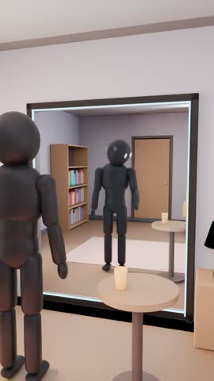 | Plano por cima do ombro: protagonista imóvel; o reflexo já se mexe e olha para o copo. | E se o seu reflexo mostrasse o que vai acontecer... |
| s02 | 3.0–4.4 | 32 mm | 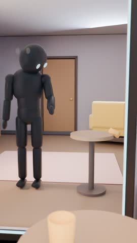 | Aproximação rápida ao espelho: no reflexo, o copo cai. | E se o seu reflexo mostrasse o que vai acontecer... |
| s03 | 4.4–5.6 | 55 mm | 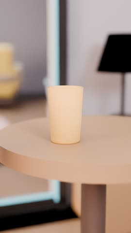 | Inserto: o copo real continua parado na mesinha. | dez segundos antes? |
| s04 | 5.6–7.2 | 40 mm | 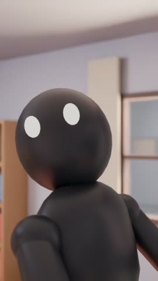 | Close do rosto: ele vira a cabeça, assustado. | dez segundos antes? |
| s05 | 7.2–10.3 | 28 mm | 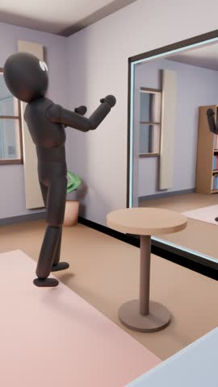 | Plano lateral: o copo real cai exatamente como no espelho; ele pula para trás. | No começo, você acha que é um truque. |
| s06 | 10.3–12.0 | 40 mm | 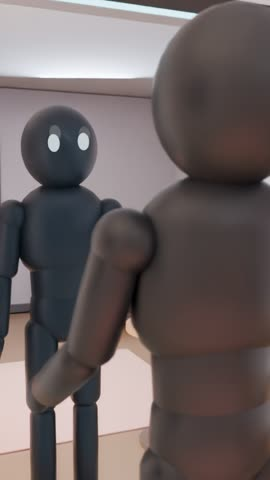 | Por cima do ombro esquerdo: o reflexo levanta a mão antes dele. | Até que tudo acontece exatamente como viu. |
| s07 | 12.0–15.0 | 35 mm | 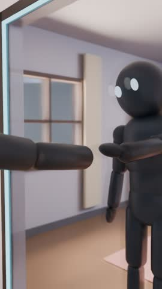 | Perfil no vidro: as mãos se encontram; a dele chega atrasada. | Até que tudo acontece exatamente como viu. |
| s08 | 15.0–16.6 | 30 mm | 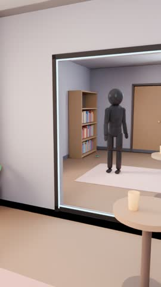 | No espelho, o vaso da estante (atrás dele) cai e se espatifa. | Então você começa a usar isso a seu favor. |
| s09 | 16.6–18.4 | 24 mm | 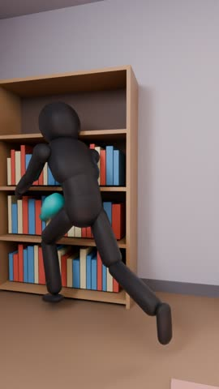 | Ele se vira, corre e pega o vaso no ar. | Então você começa a usar isso a seu favor. |
| s10 | 18.4–19.9 | 32 mm | 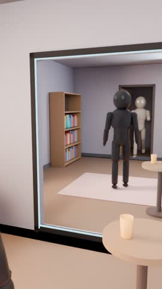 | No espelho: a porta se abre e alguém entra com um presente. | Antecipando pequenas coisas que ninguém poderia prever. |
| s11 | 19.9–21.4 | 30 mm | 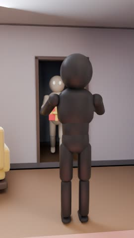 | Real: ele já espera de braços abertos quando a porta abre. | Antecipando pequenas coisas que ninguém poderia prever. |
| s12 | 21.4–22.6 | 35 mm | 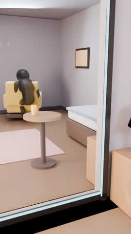 | No espelho: o reflexo tira as chaves de baixo da almofada. | Antecipando pequenas coisas que ninguém poderia prever. |
| s13 | 22.6–24.2 | 32 mm | 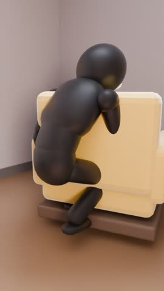 | Real: ele encontra as chaves no mesmo lugar. |  |
| s14 | 24.2–27.6 | 24 mm | 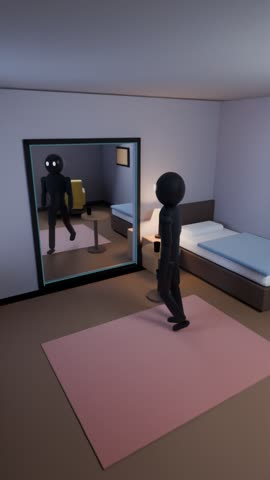 | Noite. Plano geral alto: ele caminha até o espelho. | Mas uma noite, o reflexo faz algo diferente. |
| s15 | 27.6–30.8 | 32 mm | 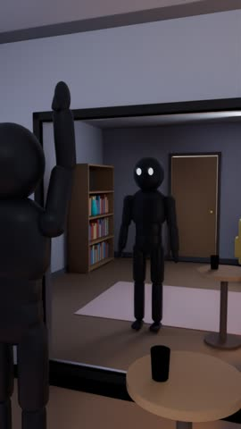 | Ele levanta o braço e acena; o reflexo não responde. | Ele para de mostrar o futuro. |
| s16 | 30.8–33.3 | 30 mm | 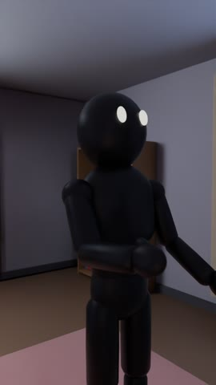 | Ângulo do espelho: ele recua devagar; o reflexo continua parado, mais perto do vidro. |  |
| s17 | 33.3–35.7 | 40 mm | 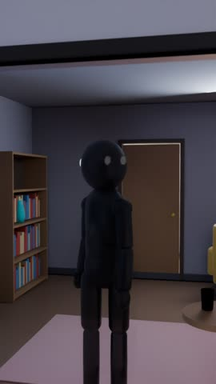 | O reflexo vira lentamente a cabeça para a porta. | Ele olha para a porta. |
| s18 | 35.7–38.1 | 60 mm | 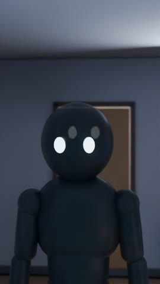 | Close: o reflexo volta a cabeça e encara você. | Depois para você. |
| s19 | 38.1–40.6 | 26 mm | 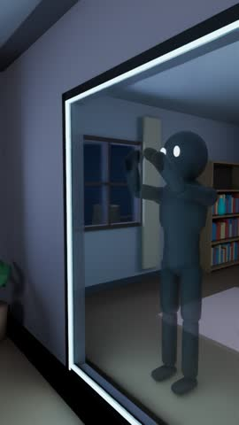 | Plano lateral: o reflexo bate as duas mãos no vidro; a luz oscila. | E começa a bater no vidro. |
| s20 | 40.6–43.2 | 38 mm | 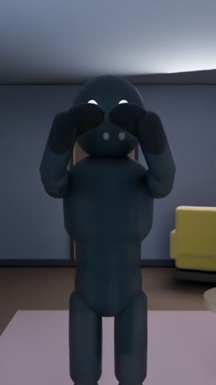 | Ponto de vista: as palmas batendo no vidro, luz piscando. |  |
| s21 | 43.2–45.6 | 24 mm | 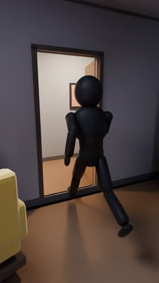 | Ele foge do quarto; câmera o persegue até a porta. | Você foge do quarto. |
| s22 | 45.6–49.4 | 22 mm | 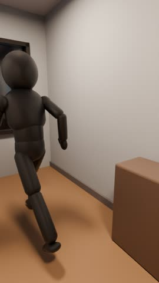 | Corredor: ele corre; as luzes apagam uma a uma. | Dez segundos depois, todas as luzes se apagam. |
| s23 | 49.4–52.2 | 30 mm | 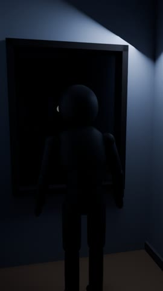 | Ele para diante da janela escura. Silêncio. |  |
| s24 | 52.2–55.0 | 32 mm | 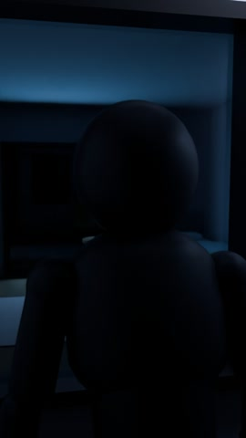 | Câmera avança por cima do ombro em direção ao vidro. | Mas quando olha para a janela... |
| s25 | 55.0–58.0 | 40 mm | 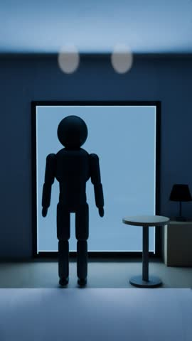 | No vidro: o quarto, e o reflexo parado diante do espelho antigo. | o seu reflexo continua no quarto. |
| s26 | 58.0–62.5 | 55 mm | 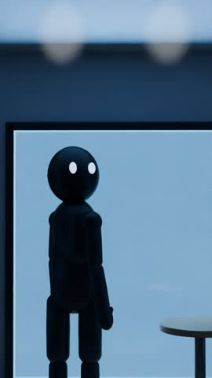 | O reflexo vira a cabeça e encara a câmera. Corte seco para preto. | Olhando diretamente para você. |
